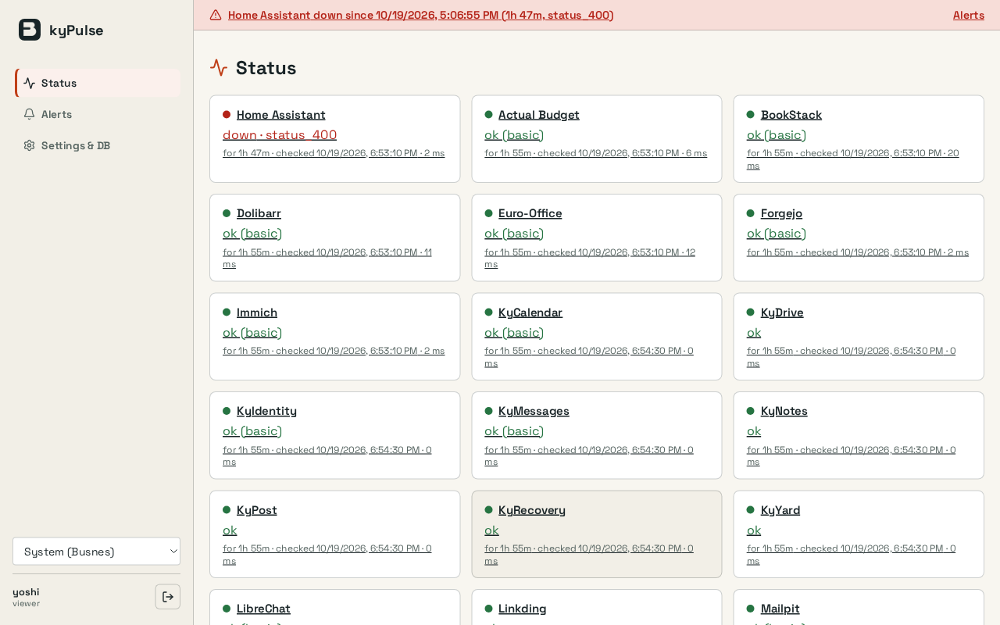
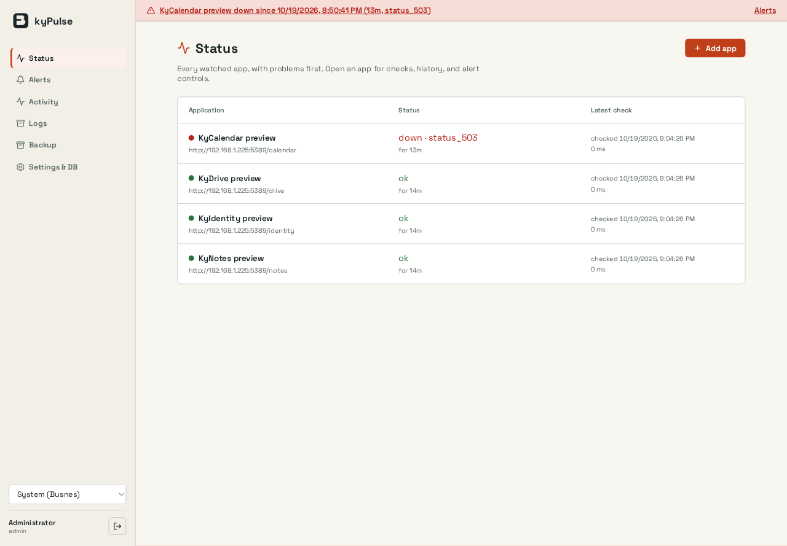
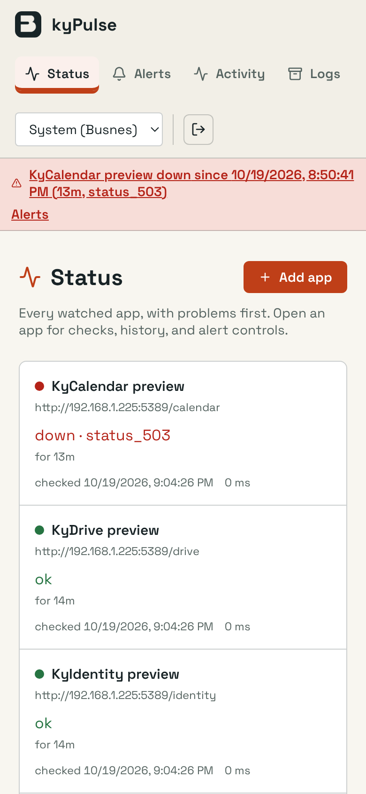
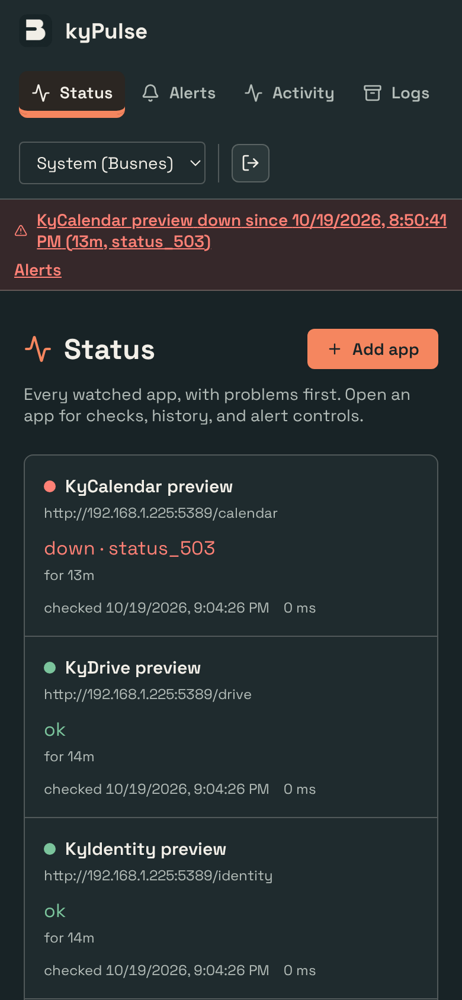

# KyPulse interface polish

KyPulse now has a compact status list with failures first and aligned check details. This implements the approved visual direction against the existing product; no mockup data or replacement application shell is shipped.

## Preserved

Target creation and detail links, polling/state ordering, causes, state age, last check/latency, silences, alerts, webhooks, logs, activity and settings.

No deployed configuration, accounts, credentials or stored content were changed. Authentication, API clients, persistence, backend logic, dependency manifests and migrations are unchanged. Product themes, palette choices and saved preference keys are retained; hash-pinned shared UI files are untouched. Existing React event-handler expressions were compared against the base revision and retained.

## Evidence

Captured 2026-10-19 from the built interface in T3's native browser, at 1440×1000 and 390×844 CSS pixels. PNG dimensions may be larger because of browser device scaling. The dark capture is a phone view. Capture conditions: Real disposable administrator and four actual polling targets served by an owned local health fixture. One endpoint deliberately returns 503. These are preview fixtures, not the health of deployed Ky services.

Before is the actual installation-campaign screenshot used for the approved proposal. After is this branch on disposable data. Their content differs; these images compare presentation, not a live-data migration.

| Before | Implemented desktop |
| --- | --- |
|  |  |

| Implemented phone | Implemented phone, dark |
| --- | --- |
|  |  |

## Checked

`npm test`: 89 tests passed. Production build passed. make ci passed. Chromium light/390: status/alerts, CSP/theme shell and admin logs/activity/pairing/viewer boundaries passed. The logs case passed after correcting the harness Go PATH.

The inspected phone state had no document-width overflow. This is targeted interface verification, not an exhaustive accessibility or nine-product integration qualification. Repository-wide CI, container/PostgreSQL/real-runtime checks and autonomous review remain separate gates.

## Review

Review [web/src/pages/Status.tsx](web/src/pages/Status.tsx) for the product layout and preserved actions. Generated assets and screenshots can be skipped when reviewing behavior. Check the source layout and existing permission/confirmation boundaries before merging. No deployment or merge is included.
