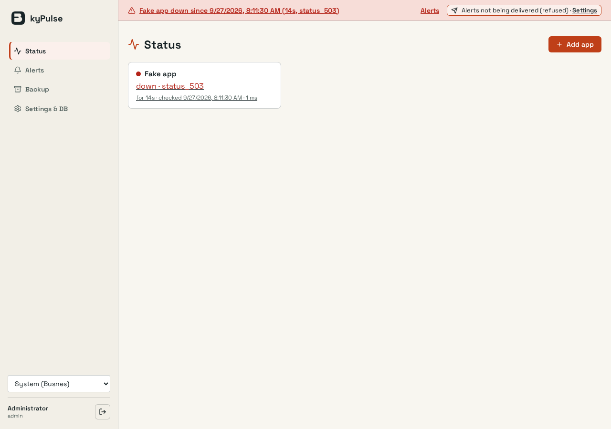
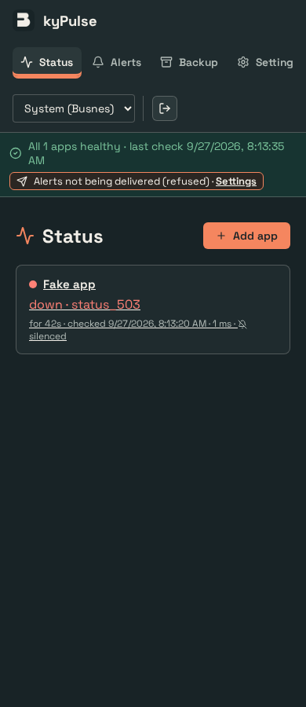
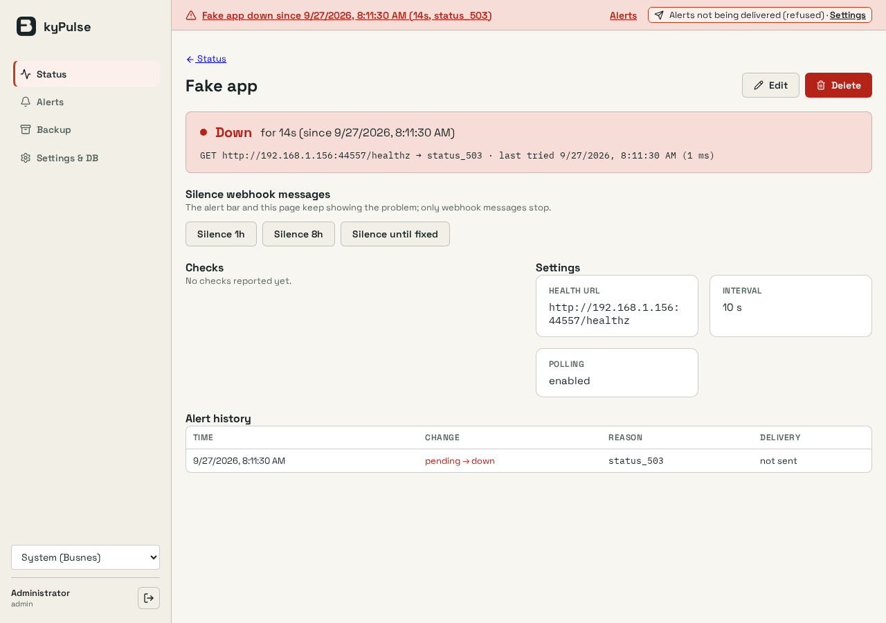
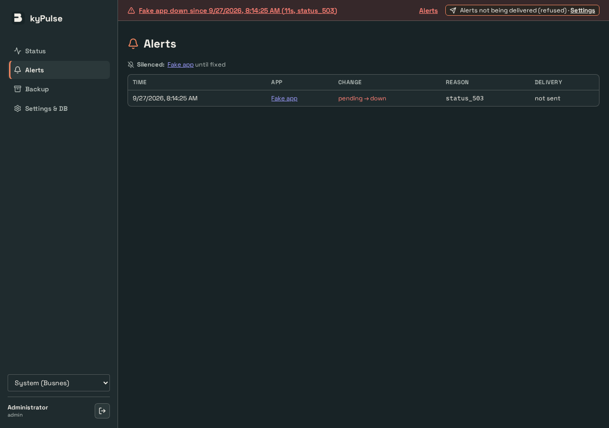

# UI verification

> Evidence scope: this document records the revision, environment and capture conditions below. Screenshots and generated fixtures demonstrate appearance; they do not qualify live email delivery, push delivery, recovery custody or every product feature. Test counts describe that recorded run, not the current suite.

KyPulse screens: alert bar, Status, Alerts, app detail, webhook, admin Logs/Activity and KyYard collection status.

## Capture conditions

Captured by `web/browser/monitor.spec.mjs` against the real Go server with disposable SQLite
data, production CSP and real login, at 1280×900 and 390×900 in Busnes Light and Dark. The
watched app is a fake `ky.health/1` server on the runner's LAN address; the webhook is the
same server answering 500.

## Checks

`npm test` (vitest: router, monitor helpers and client, AlertBar, Status, Alerts, AppDetail,
WebhookForm, KyYardCard, Backup, ChangePassword) and `npm run test:browser` (shell spec plus
the monitor spec: empty install, add app, down after three polls, red bar linking to the
detail page, checks, silence until fixed, Alerts table and silences, webhook saved, test send
failing, "Alerts not being delivered", recovery to green with the silence cleared, delete back
to Status, no horizontal overflow). Viewer-role rendering of Status, Alerts and the detail page
is covered by component tests; the `#/backup` redirect and the Settings webhook gate rely on
the server's 403s (`internal/api` authorisation tests).

`logs.spec.mjs` also runs a fake KyYard on the private interface and exercises real pairing,
linked-container collection on the 60-second worker, and independent inventory/log/audit
status on Logs, Activity and Settings. The fake's old array audit API remains visibly
unsupported while inventory and logs succeed. The same case verifies source pairing,
filters, pagination, offline retry, plain-text rendering, burst hints and real viewer denial.
Component tests cover stale ages and separate errors; container facts/suggestion variants
retain their component coverage. This is not a real KyYard deployment or Docker-engine soak.

Logs and Activity screenshots are saved per project under ignored `web/test-results/`;
existing committed screenshots below cover the monitoring screens.

## Screenshots

| | |
| --- | --- |
|  |  |
|  |  |

## Reproduce

Build the frontend, run `go build -o .browser/server ./cmd/server` at the repo root, then
`cd web && npx playwright install chromium && npm run test:browser`. The monitor spec skips on
a machine with no private IPv4 interface.

## Approved interface polish — 2026-10-19

See [UI-POLISH.md](UI-POLISH.md) for the implemented changes, preservation scope, checks, actual before/after screenshots and disposable capture conditions. Earlier captures above remain historical evidence.

## 2026-10-26 fleet Appearance

ky-ui 0.4.0 (shared source `4f83f34`): the Appearance theme-card picker over the shared catalog, plus shell geometry from shared tokens. Before/after screenshots, capture conditions, hashes, real-browser behaviour checks and the results spreadsheet are in [docs/ui-fleet-2026-10-26](docs/ui-fleet-2026-10-26/README.md). Ratings are set by the independent council, not this record.

### Review F1: status contrast

All six newly available light palettes now tint error/success toward their own ink. The five original base palettes keep their status values. The real production-server browser test failed in all four OS/width projects before the fix (error contrast 3.29:1 on Light Matter), and passes in all four afterward; the minimum measured status contrast is 7.70:1 across both surfaces. `docs/ui-fleet-2026-10-26/f1-before/` and `f1-after/` preserve matching Sky Appearance captures, per-project ratios, source patch and exact capture conditions (mobile regression viewport390x900). Frontend unit tests and typecheck/build passed. Earlier backend checks remain applicable to unchanged Go source; current-head CI is required after pushing. DOX: updated web/AGENTS.md with the status-color contract; parent ownership/index unchanged.

### Review F7: filled danger button label

The F1 tint darkened the filled danger fill on light suite palettes, whose dark `--button-text` label then read at 1.18–1.69:1. For the 15 suite palettes only (the F1 qualifier), `.btn-danger` now labels with `--bg`. `browser/danger-button.spec.mjs` measures screenshot pixels of the real Delete button on a disabled synthetic app, never clicked, in OS light and dark at 1280px. It covers rest, hover (opacity 0.9) and keyboard focus across all 15 palettes, and asserts that Busnes and the five base palettes keep `--button-text`. Before the fix it failed (Polished Ky 1.23 at rest, 1.18 on hover); after, the minimum is 5.89 at rest and 5.03 on hover (Dark Matter). Captures are stages 05 and 06 in [docs/ui-fleet-2026-10-26](docs/ui-fleet-2026-10-26/README.md). Disabled buttons (opacity 0.5) are not measured; WCAG exempts inactive controls.

## Fleet visual refinement (2026-10-26)

App detail: the Status back link uses page ink, settings facts are flat label/value rows, and Delete moves from the page header to a closing Stop watching section, still the filled `.btn-danger` measured by `browser/danger-button.spec.mjs`. Before/after captures (light/dark × 1280×900/390×844, synthetic fixture, clean commits), manifests with hashes, behaviour checks and CSVs are in [docs/ui-visual-refinement-2026-10-26](docs/ui-visual-refinement-2026-10-26/README.md). No score is self-assigned.

## Review follow-up R2 (2026-10-26)

The flat `.dr-facts` rows had moved Backup's status badges (None, Not paired, 0 of 7) under their labels at 1280px. The rows now share one label column, at least 8rem and as wide as the widest label with its badge, so every badge sits beside its label while app detail keeps its 8rem column and value edge. Before/after captures of Backup and app detail (light/dark × 1280×900/390×844), manifests and the reviewer's harness rerun (failing before, passing after) are in [docs/ui-review-followups-2026-10-26](docs/ui-review-followups-2026-10-26/README.md).
